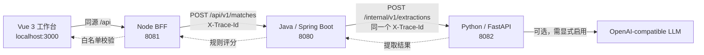

# 15 分钟答辩稿（可直接照讲）

适用版本：v0.1 已提交代码（feature 分支 629f778 / main 合并提交 30158f4）。日期：2026-11-05，Asia/Shanghai。
本文档中的验证结果以 [DELIVERY.md](../DELIVERY.md) 的最新运行事实为准；**没有实际跑过的检查不得当作通过来讲**。

## 0. 开场前 2 分钟（不讲，只做）

1. `docker compose ps`：四个服务都要是 `healthy`。
2. `python scripts/demo_chain.py --no-logs`：确认最后一行是 `PASS`。
3. 打开 http://localhost:3000，先别点「分析匹配」。
4. 准备两个窗口：终端（放演示脚本输出）和浏览器（放工作台）。
5. 备用截图：`output/playwright/desktop.png`、`output/playwright/mobile.png`（本机生成，Git 忽略，答辩前确认存在）。

如果第 1 步不健康：`docker compose up -d --no-build --wait --wait-timeout 120`，仍失败就切到「兜底话术」（第 8 节），不要现场猜原因。

---

## 1. 时间分配总表

| 时间 | 环节 | 目的 | 证据 |
| --- | --- | --- | --- |
| 0:00–1:30 | 业务与约束 | 讲清闭环、四层强约束、不做的事 | 首屏 / 架构图 |
| 1:30–3:30 | 架构与请求链 | 谁校验、谁评分、谁提取、trace 怎么走 | Mermaid 图 + 契约文档 |
| 3:30–8:30 | 现场演示（核心） | 一次真实请求贯穿四层，同一 trace | `scripts/demo_chain.py` 输出 + 浏览器 |
| 8:30–11:00 | 工程质量 | 单测 / 契约 / 浏览器 / Docker / CI / 发布清单 | 命令与 run 链接 |
| 11:00–13:00 | 架构取舍 | 为什么这样分层、为什么不持久化、降级语义 | 开发与契约文档 |
| 13:00–15:00 | 缺口与问答 | 主动暴露未验证项，预设问答 | DELIVERY.md 已知缺口 |

---

## 2. 逐字稿

### 0:00–1:30 · 业务与约束

> 「这个项目叫 CareerLens，做的是一件事：把**简历文本 + 岗位 JD** 变成**结构化简历、命中证据、能力缺口和一个可解释的分数**。
> 题目给的是硬约束：请求链必须是 Vue 3 → Node BFF → Java / Spring Boot → Python → OpenAI-compatible 模型，浏览器只能调 BFF。
> 我先说清楚三条边界：第一，输出里的每一条命中都要能点回原文行；第二，缺失只能说『简历中未发现证据』，不能说求职者不会；第三，分数是加权技能覆盖度，**不是录用概率**，没有可识别要求时不给分而是 null。
> 另外按题目要求，四个服务只用 Docker/Compose 跑，端口固定 3000 / 8080 / 8081 / 8082，并只绑定 127.0.0.1，浏览器走前端同源 `/api`。」

（指屏幕：打开工作台，展示两个输入框和「载入虚构示例」按钮。）

### 1:30–3:30 · 架构与请求链

> 「一次点击会走完这条链。」



> 「分工是刻意的：BFF 只做字段白名单、参数校验、请求编排、超时和统一错误映射，**不碰评分也不碰数据库**；Java 持有领域 DTO、规则版本和最终 `ScorePolicy`；Python 负责清洗、技能归一、模型输出验证和提取降级；模型只被 Python 调用。
> 所有业务响应统一 `{ code, msg, data }`，追踪号只走 `X-Trace-Id` 响应头。BFF **不接受客户端伪造 trace**，自己生成 UUID，再一路传给 Java 和 Python，所以排查时一个 trace 能串起三层日志。
> 还有一层安全设计：Python 返回的是结构化提取与证据，**没有 matches、gaps 和 score**；这些由 Java 按版本化权重算出来，避免模型措辞一变分数就变。」

（可翻到 [API_CONTRACT.md](API_CONTRACT.md) 第 2–4 节，指向三字段 DTO 和 `analysis-v1` / `skills-v1` 版本字段。）

### 3:30–8:30 · 现场演示（核心 5 分钟）

**第 1 步（40 秒）· 跑脚本，不要先讲代码。**

```sh
python scripts/demo_chain.py
```

> 「先看第 1 段：四个健康探针全 200。第 2 段是从浏览器入口发出的一次真实分析——注意这里只用了合成材料。」

（默认命令不外发外部模型；只有在**确认运行时未配置真实模型 key** 时，才可在重跑时加 `--include-degradation` 演示降级。脚本会打印警告，并在检测到 `mode=llm` 时提示合成材料已发往真实网关。）

**第 2 步（60 秒）· 念输出，逐项对照。**

> 「HTTP 200、`code=OK`、信封只有三个字段。链路 trace 是这一串（念屏幕上的 UUID）。`mode=rules` 说明这次走规则提取，不是模型；命中 Java、Spring Boot，缺口 Docker，分数 86/100，分子 6、分母 7。
> 下面这行是我最想让大家看的：缺口措辞是『简历中未发现 Docker 证据。』——**不是『不会 Docker』**。证据 3 条，每条都能点回原文行。」

**第 3 步（60 秒）· 同一 trace 的跨层证据。**

> 「第 3 段是容器日志。同一个 trace 在 bff、domain-api、ai-service 三行里完全一致（念屏幕上三行各自的实时耗时，不要写死数字）。脚本对『三个服务都命中』做了断言；如果加了 `--no-logs`，它会明确写『已跳过』而不是假装通过。这就证明了请求确实一层层走下去，不是前端本地算的。
> 顺便说明：客户端如果自己塞一个 `X-Trace-Id`，BFF 会丢弃并重新生成，这是防伪造的设计。」

**第 4 步（70 秒）· 逐层直连，证明归属。**

> 「第 4 段我按契约直接打 8081 / 8080 / 8082。看最后一列：BFF 和 Java 的响应里『分数=有』，Python 『分数=无』，但 Python 给了 3 条 requirements。这就是『Python 提取、Java 评分』的代码级证据。
> 直连 BFF 时响应 trace 与刚才不同，因为 BFF 每次都新生成；Java 和 Python 会复用我指定的 trace。」

**第 5 步（50 秒）· 边界与降级。**

> 「第 5 段：空白简历和未知字段都是 400 `INVALID_INPUT`；170 KB 文本是 413 `PAYLOAD_TOO_LARGE`；JD 里没有可识别技能时 `score.value=null`，理由 `NO_RECOGNIZED_REQUIREMENTS`——不会硬给 0 分。
> 降级那一条默认不发请求；只有确认无真实 key 并加 `--include-degradation` 重跑时，才会看到 `mode=degraded` 和对应警告码（随失败原因变化，例如 `LLM_NOT_CONFIGURED` 或 `LLM_TIMEOUT`）。**降级必须被看见，不能冒充模型成功**。」

**第 6 步（60 秒）· 回到浏览器做人工可感知的部分。**

1. 点「载入虚构示例」→「分析匹配」。
2. 点第一条命中的「查看原文」，展示高亮定位。
3. 切到「结构化简历」页签，展示项目/技能与证据编号。
4. 修改 JD，展示「材料已修改，以下是上一次分析结果。请重新分析。」的陈旧结果提示。
5. 点「导出 JSON」，说明导出由用户主动触发、页面刷新即丢失材料。

> 「刚才脚本里是同一份合成材料的 HTTP 视角，这里是用户视角：证据定位、结构化结果、陈旧结果提醒和可解释分数。」

（想用招聘网站风格的长 JD：加 `--jd-file tests/fixtures/jd-synthetic.txt`，来源与脱敏记录见 [JD_TEST_SAMPLE.md](JD_TEST_SAMPLE.md)。那份明确是虚构测试稿，不是真实招聘信息。）

### 8:30–11:00 · 工程质量

> 「验证分三类，我不混着说：**本机已跑、远端已跑、尚未跑**。」

念以下事实（按 [DELIVERY.md](../DELIVERY.md) 最新记录核对后再讲）：

- 本机单测：前端 3（vitest）+ BFF 9（node:test）+ Java 15（JUnit）+ Python 17（pytest）= **44 项通过**。
- 本机契约/集成：`python scripts/smoke.py` 通过，覆盖四层真实 HTTP、400/413、长 Unicode 边界、空要求、`degraded`；`docker compose config -q` 通过。
- 本机浏览器：`.venv/Scripts/python.exe tests/e2e/browser.py` 通过（真实分析、证据高亮、结构化页签、陈旧提示、导出、超时恢复、取消、1440/390/320px）。本机第一次失败是缺 Chromium 二进制，安装后重跑通过——这个失败要如实说。
- 远端 CI：feature push `42051190947` 成功、PR `42051203482` 成功、main 合并后 push `42053405971` 成功（含四镜像构建、真实 HTTP 链、浏览器验收、合成模型网关）。**只证明受控模型协议，不证明真实付费模型质量**。
- 发布：`scripts/release.py --snapshot` 生成四镜像 SHA 清单，保留 `keep-*` 标签，不删镜像；`--deploy` 用精确 image ID 整链重建并复验。是否已演练以 DELIVERY.md 为准。
- 门禁：main 保护在当前 GitHub 套餐下 API 返回 403，**没有平台强制门禁**。PR #2 已于 23:17 合并进 main（`30158f4`），合并时无 review / 评论，并连带触发 CD run `42054682893` 自动向 GHCR 发布；是否符合「用户本人明确人工审核通过」需用户确认。讲到这里必须主动说明，**既不能说「尚未合并」，也不能说「已获人工批准」**。

### 11:00–13:00 · 架构取舍

> 「四层不是我喜欢分层，是题目强约束；在这个约束下我把确定性放在 Java：同一份提取结果必须得到同一个分数，所以权重和规则版本不交给模型。
> Python 这层把模型当作**不可信输入**：只接受白名单技能 ID，验证 evidence 引用，失败就降级；模型 URL 只由运维配置，浏览器和前端都不能给。
> BFF 不连数据库、不存原始材料，MVP 没有账号、没有历史、没有 localStorage，刷新就丢——这是明确的隐私取舍，代价是用户得重新粘贴。
> 没有引入 Agent、向量库、ORM 迁移和 PDF/OCR；接口留了 `contractVersion` 和 `skillDictionaryVersion`，破坏性变更要升版本，四层不能混搭发布。
> 回滚是四个服务**同一份 release 清单**一起回切，不单独回滚某一层；模型密钥和 `.env` 独立于清单。」

详细取舍见 [DEVELOPMENT.md](DEVELOPMENT.md)。

### 13:00–15:00 · 缺口与问答

> 「最后我主动说没做完、以及有争议的地方：真实付费模型调用没有验证；CD 已经自动发布过一次，但 GHCR digest 没有独立核验；跨版本 A→B→A 回滚只演练了清单切换机制，没有两个不同代码的镜像；公网部署前的认证、TLS、限流没做；私有库平台分支保护拿不到，PR #2 的合并是否符合人工门禁还要确认；只读审查还发现 Java 侧没有把 evidence 文本与原始简历交叉核对、部分 413/415/405 被压成 502，这些是已提交代码的缺口；规则提取理解不了复杂语义和否定，所以界面必须标 `rules` / `degraded`；PDF/OCR、简历历史、跨浏览器和精度评测都还没做。分数不预测录用结果。」

---

## 3. 预设问答（按被问概率排序）

| 问题 | 答法要点 |
| --- | --- |
| 为什么前端不能直接调 Java？ | 题目强约束 + BFF 承担白名单/超时/统一错误；浏览器只认同源 `/api`；直连端口仅用于 Postman/curl 调试，均在 127.0.0.1。 |
| 分数怎么算，会不会被模型带偏？ | `required=3 / unspecified=2 / preferred=1`，`matchedWeight / totalWeight` 由 Java `ScorePolicy` 回填；Python 不返回 weight 和 score；分母 0 返回 null。 |
| 模型挂了怎么办？ | `auto` 下降级到规则并给 warning，`required` 返回 503/504；UI 展示 `rules` / `degraded`，不把规则结果说成模型结果。 |
| trace 为什么前端传了没用？ | BFF 用 `randomUUID()` 重新生成，防止伪造与日志注入；Java/Python 复用上游合法 UUID，非法值各自重新生成。 |
| 简历内容会存下来吗？ | 不持久化、不默认 localStorage、不写入日志正文；导出 JSON 需用户主动点击；日志只记 service/trace/status/耗时。 |
| 长文本/emoji 会不会崩？ | 请求 UTF-8 上限 160 KiB、长度按 Unicode code point；曾出现 Java JSON escape 膨胀触发 Python 413，已修并保留 15000 emoji 的真实链路回归。 |
| 怎么证明不是前端伪造结果？ | 逐层直连 8081/8080/8082，Python 无 score、Java 有 score；同一 trace 的三层日志；`scripts/smoke.py` 用真实 HTTP 断言。 |
| CI 全绿是不是就能上线？ | 不是。远端绿色只覆盖合成网关与本机 Docker；真实模型、GHCR 发布、公网鉴权/TLS、用户人工审核都未完成，且人工审核不能由 AI review 代替。 |
| 既然人工审核前不能合并，为什么 main 已经有代码？ | PR #2 在 23:17 由账号本人合并，但无 review / 评论记录；是否符合「用户本人明确人工审核通过」需要确认。本轮不擅自 revert、不强推、不重写历史，已在 DELIVERY.md 标为 P0 待确认。合并还连带触发了 CD 自动发布，这也是要补人工门禁的原因。 |
| 回滚怎么保证四层一致？ | 一份清单含 Git SHA、四个 image digest、契约版本、词典 hash；`--deploy` 以精确 image ID 整链 `--force-recreate` 并跑 smoke；不单独回滚一层。当前只验证了同内容镜像的清单切换，跨版本回切未演练。 |
| 真实 JD 能用吗？ | 演示只用明确虚构的合成稿（[JD_TEST_SAMPLE.md](JD_TEST_SAMPLE.md) 记录来源、访问日期与脱敏）；真实简历/JD 联系方式不提交、不进 Git 或镜像上下文。 |

---

## 4. 演示命令速查

| 目的 | 命令 |
| --- | --- |
| 四容器状态 | `docker compose ps` |
| 启动 / 重建 | `docker compose up -d --no-build --wait --wait-timeout 120` |
| 单测 | `npm test` · `mvn -B -s services/domain-api/settings.xml -f services/domain-api/pom.xml test` · `python -m pytest services/ai-service/tests -q` |
| 契约/集成 | `python scripts/smoke.py` |
| 浏览器 | `.venv/Scripts/python.exe tests/e2e/browser.py` |
| 答辩主脚本 | `python scripts/demo_chain.py` |
| 文档静态检查 | `python scripts/check_docs.py` |
| 快照 / 回滚 | `python scripts/release.py --snapshot <name>` · `python scripts/release.py --deploy output/releases/<name>.json` |

逐步演示说明与 curl 等价命令见 [DEMO_REQUEST_CHAIN.md](DEMO_REQUEST_CHAIN.md)。

---

## 5. 不能说的话（合规红线）

- 不把「规则模式结果」「合成网关测试」说成「真实大模型验证通过」。
- 不把远端文档 CI 或早期绿色 run 说成「最新代码全绿」；以当前 commit 的 run 为准。
- 不把 AI code review 或绿色 CI 说成「用户已人工审核批准」。
- 不把未执行的回滚演练、GHCR 发布、压测、真实简历精度评测记为通过。
- 不宣称私有库已有平台强制分支保护（API 实际 403）。
- 不说「求职者不具备某能力」，只说「简历中未发现证据」。
- 不在幻灯片、日志或导出的 JSON 中放真实简历、JD 联系方式、key、token。

## 6. 兜底话术（现场服务起不来）

> 「这一路依赖四个容器，我现在不现场 debug，避免把演示变成排障。已经记录的同版本验证结果是：本机四层 smoke 与浏览器验收通过、远端 CI 有对应 commit 的绿色 run；这是当时的截图和脚本输出（展示备用截图 / `output/demo/` 报告）。我现在用静态证据把请求链和归属讲完。」

- 备用静态证据：`output/playwright/desktop.png`、`output/playwright/mobile.png`、`output/demo/chain-*.json`（只含状态码、trace、计数，不含材料）。
- 绝不现场伪造一次"通过"的输出。
